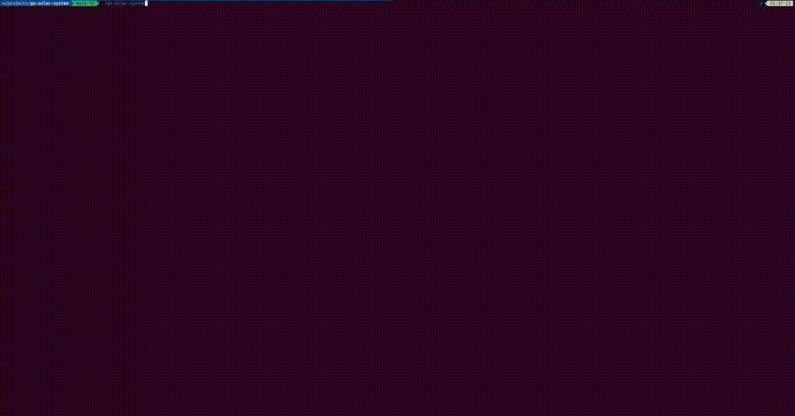

# Go Solar System Explorer 🚀

Terminal app where you can explore solar systems.




## What it does

- Navigate around planets with your keyboard & mouse
- Has some neat visualizations with planet information
- Can switch between different star systems (Solar System, Alpha Centauri, etc)
- Real-time orbital animations for our solar system

## How to run it

```bash
git clone https://github.com/furan917/go-solar-system.git
cd go-solar-system
go mod download
go build
```

That should work. If it doesn't, check if you have Go installed?

## Controls (the important stuff)

**Basic navigation:**
- Arrow keys = move around
- Enter = see planet details
- Numbers 1-9 = jump to specific planets/sun
- S = switch between star systems
- Q = quit (or Escape, whatever)

**In the system list:**
- Up/Down = navigate, Enter = switch to that system
- / = filter the list, then type. Backspace edits, Escape clears the filter
- Escape/B = close the list

**When looking at planet details:**
- M = view moons (if the planet has any)
- B = go back
- Q = still quits

**Moon stuff:**
- Up/Down = navigate moon list
- Enter = moon details
- Escape/B = back to planet

## Current features (aka what actually works)

- ✅ All the basic planet browsing stuff
- ✅ Multiple star systems with actual exoplanet data
- ✅ Binary system support
- ✅ Orbital animations
- ✅ Asteroid and kuiper belt represented
- ✅ Load your own systems from your config directory
- ✅ Smooth sub-cell orbit curves, so it still looks right in a smaller terminal

## What's still broken/TODO

- Some UI components need improvement
- The help system could be better (i.e could exist)
- Probably need more error handling
- Could use more star systems 

## Testing

```bash
go test ./...
```

Tests exist and they pass (usually).

## Data sources

Uses real data from:
- [Solar System OpenData API](https://api.le-systeme-solaire.net/en/)
- NASA/JPL databases
- Various exoplanet catalogs

## Star systems included

- **Solar System**: Our neighborhood (obviously)
- **Alpha Centauri**: Closest star system with some interesting planets
- **Kepler-452**: Has "Earth's cousin" planet
- **TRAPPIST-1**: 7 Earth-sized planets, pretty cool

## Adding your own star systems

Drop a JSON file into `~/.config/go-solar-system/systems/` and it shows up in the system list next time you start the app. No rebuild needed.

```bash
mkdir -p ~/.config/go-solar-system/systems
cp my-system.json ~/.config/go-solar-system/systems/
```

The filename becomes the system id, and a file that matches a bundled system's name replaces it. Set `GO_SOLAR_SYSTEM_SYSTEMS_DIR` to scan an extra directory as well. See [systems/README.md](./systems/README.md) for the format.

## If orbits render as empty boxes

Orbit paths are drawn with braille characters, which gives them 8x the resolution of the terminal grid and keeps circles smooth in smaller windows. If your font lacks braille coverage you'll see blank boxes instead of curves. Fall back to plain dots with:

```bash
GO_SOLAR_SYSTEM_SIMPLE_ORBITS=1 go-solar-system
```

## Contributing

Sure, if you want to help out:

1. Fork it
2. Make changes
3. Don't break anything
4. Submit a PR

Standard stuff.

## License

MIT License - do whatever you want with it.

---

*Built with Go and still a work in progress but it's getting there.*
